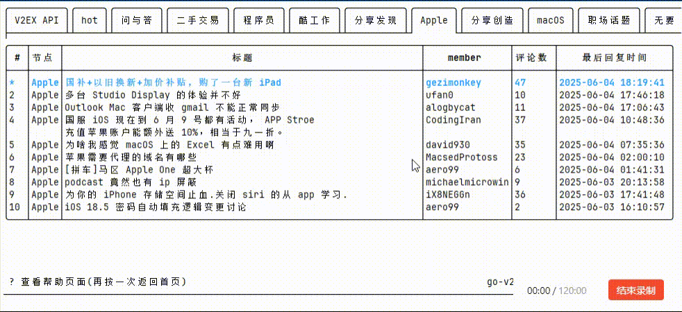
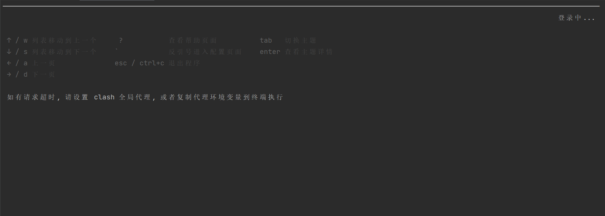
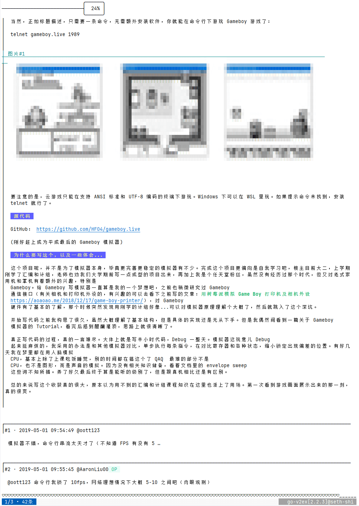

## go-v2ex
一个基于 **Go** 开发的终端版 **V2EX** 客户端。宽屏采用紧凑的单行主题表格，窄屏自动使用双行列表，支持浏览主题和评论、切换节点、刷新重试及本地浏览历史。不配置令牌也能浏览公开内容。


## 安装使用

* 下载最新版本二进制文件

| 系统      | CPU 架构     | 下载链接                                                                                                                    |
|---------|------------|-------------------------------------------------------------------------------------------------------------------------|
| Mac     | amd64      | [go-v2ex-darwin-amd64.tar.gz](https://github.com/seth-shi/go-v2ex/releases/latest/download/go-v2ex-darwin-amd64.tar.gz) |
| Mac     | arm64      | [go-v2ex-darwin-arm64.tar.gz](https://github.com/seth-shi/go-v2ex/releases/latest/download/go-v2ex-darwin-arm64.tar.gz) |
| Linux   | amd64      | [go-v2ex-linux-amd64.tar.gz](https://github.com/seth-shi/go-v2ex/releases/latest/download/go-v2ex-linux-amd64.tar.gz)   |
| Linux   | arm64      | [go-v2ex-linux-arm64.tar.gz](https://github.com/seth-shi/go-v2ex/releases/latest/download/go-v2ex-linux-arm64.tar.gz)   |
| Windows | amd64      | [go-v2ex-windows-amd64.zip](https://github.com/seth-shi/go-v2ex/releases/latest/download/go-v2ex-windows-amd64.zip)     |
| Go      | 直装(免配环境变量) | `go install github.com/seth-shi/go-v2ex/v2@latest`                                                                      |
* 解压压缩包中的二进制文件放到环境变量目录
* 运行 `go-v2ex` 命令即可启动程序。

## 功能特性
- **紧凑布局**：80 列及以上对齐显示节点、标题、作者、回复和活跃时间，窄屏使用双行列表；整行蓝色高亮选中项，适配浅深色终端
- **刷新重试**：按 `Ctrl+R` 获取最新内容；请求失败后可重试，已有内容保留可读
- **本地历史**：按 `v` 查看最近读过的主题，支持重新打开，已读主题在列表中标记
- **自动更新**：按 `u` 键可从 GitHub 检查并安装最新版本
- **支持预览图片**：支持查看图片
- **多节点切换**：支持自定义节点列表
- **主题浏览**：查看最新/热门主题，支持分页翻页
- **详情查看**：查看主题完整内容及评论列表（支持加载更多评论）
- **快捷操作**：通过快捷键快速切换页面、退出程序等
- **配置管理**：支持设置 API 令牌（用于部分高级功能）和自定义节点列表

## 常用快捷键

| 按键 | 作用 |
| --- | --- |
| `↑` / `↓`、`j` / `k` | 选择主题、历史记录，或滚动正文 |
| `←` / `→`、`h` / `l` | 主题列表翻页 |
| `Tab` / `Shift+Tab` | 切换节点 |
| `Enter` | 打开主题；详情页加载更多评论 |
| `Ctrl+R` | 在主题或详情页刷新、重试失败请求 |
| `v` | 在浏览页面打开本地历史 |
| `r` | 在详情页解码图片和 Base64 |
| `F1` | 在详情页用浏览器打开原帖；设置页打开配置文件 |
| `,` / 反引号 | 打开设置 / 返回 |
| `?` | 打开 / 关闭快捷键帮助 |
| `q` | 返回上一页；主题列表退出 |
| `Esc` / `Ctrl+C` | 退出程序 |
| `Space` | 老板键 |
| `=` | 切换底栏显示模式 |
| `u` | 检查并安装更新 |

### 本地浏览历史

主题成功打开后才会记录历史。历史按最近访问排序，相同主题再次打开会移到顶部，最多保存 200 条。

历史保存在用户目录的 `.go-v2ex-history.json`，与令牌配置文件分开，仅记录主题标题、链接、作者、节点和访问时间。历史保留在本机，不会同步到 V2EX。

## 预览图
以下为旧版界面预览；当前版本保留紧凑表格结构，并增加整行选中高亮、刷新重试和本地历史。






## 帮助
### 设置默认终端代理
  * 确认已开启**Clash**等代理软件,
#### JetBrains
  * **设置** -> **工具** -> **终端** --> **项目设置:代环境变量**填入以下值
  * `http_proxy=http://127.0.0.1:7897;https_proxy=http://127.0.0.1:7897`
  * 随后打开一个新的终端窗口，开始享受~~~
#### vscode
* 打开设置, 搜索`terminal.integrated.env`
* 点击**在 settings.json 中编辑**, 增加以下配置
```json
{
  "terminal.integrated.env.linux": {
    "HTTP_PROXY": "http://127.0.0.1:7897",
    "HTTPS_PROXY": "http://127.0.0.1:7897"
  },
  "terminal.integrated.env.windows": {
    "HTTP_PROXY": "http://127.0.0.1:7897",
    "HTTPS_PROXY": "http://127.0.0.1:7897"
  }
}
```

## TODO 
- [x] 统一获取配置
- [x] 终端显示图片
- [x] 自动更新应用

## 感谢
* [https://github.com/charmbracelet/bubbletea](https://github.com/charmbracelet/bubbletea)
* [https://github.com/charmbracelet/bubbles](https://github.com/charmbracelet/bubbles)
